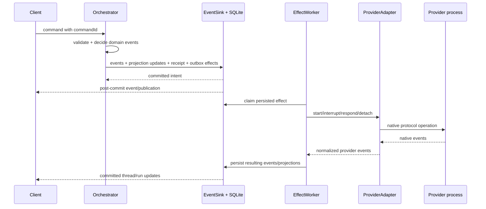

# 13 — T3 Code Orchestration Analysis

**Status:** source-inspected research; not a dependency decision  
**Inspection date:** 2026-11-19  
**Repository:** <https://github.com/pingdotgg/t3code>  
**Commit:** [`a6d2bed55b8ea1b4be27c9c77fdd65e0e7d479d5`](https://github.com/pingdotgg/t3code/tree/a6d2bed55b8ea1b4be27c9c77fdd65e0e7d479d5)  
**License:** MIT, read from the cloned `LICENSE`  
**Local evidence:** `/home/deval/.hermes/cache/scratch/t3code`  
**Coverage:** architecture documentation, the v2 orchestrator, event sink/outbox, effect worker, recovery, provider switching, provider constraints, and source-control documentation. No T3 runtime or test suite was executed.

---

## 1. Executive conclusion

T3 Code is a coding-agent control plane, not a task-to-resource intelligence router. Its useful lessons for this project are structural:

1. Separate the application's thread/run identity from each provider's native session/thread/turn identity.
2. Treat a provider **instance** as the account and configuration boundary; a driver is only the integration type.
3. Normalize provider-specific behavior behind capabilities and an event contract.
4. Commit intent, projections, command receipts, and follow-up effects atomically before performing external side effects.
5. Make recovery explicit about what can be replayed, resumed, requeued, or must be cancelled.
6. Isolate concurrent code work with workspaces/worktrees and never widen provider permissions implicitly.

T3 does **not** replace the proposed AI Orchestrator. It does not supply this project's required System 1 policy for choosing the smallest capable resource across LLM APIs, gateways, coding CLIs, local model servers, and browser resources. Nor does adopting T3 as a whole make sense: it would introduce a second user interface and an Effect-TS application stack behind Hermes.

Use T3 as a **reference implementation**, not as an initial runtime dependency.

## 2. Corrections to the older research

The T3 subsection in [`parts/03-aionui-t3code-ccswitch.md`](parts/03-aionui-t3code-ccswitch.md) predates this inspection. The current source requires these corrections:

| Older statement | Current evidence |
|---|---|
| “No multi-account per provider” | T3 distinguishes a driver from a provider instance and explicitly assigns credentials, catalogs, and mutable session state to the instance. See `docs/internals/providers.md:3-10` and `docs/internals/adding-a-provider.md:39-49`. |
| “No PR creation, diff review UI, or GitHub/GitLab integration found” | Current user documentation covers turn diffs, commit/push/PR creation, hosted PR review, and several forges. See `docs/user/source-control.md:1-21,178-200`. |
| “Each agent thread gets its own worktree” | Worktrees are a workspace strategy, not an unconditional property of every thread. The architecture supports worktree-backed and other workspace modes. The specification should say **per-task isolated worktree when requested**, not “always.” |
| “Subagents are native `task` children only” | Current recovery distinguishes `app_owned` delegation from `provider_native` subagents. App-owned children have their own thread and report back through the application. See `ProviderRuntimeRecoveryService.ts:111-129`. |

Those older statements must not drive the design.

## 3. T3's actual ownership model

T3 places provider processes, terminals, Git, and project files in the server environment that owns the workspace. Web, desktop, and mobile clients control that server over authenticated RPC; a remote client does not substitute its own filesystem or credentials ([`docs/internals/overview.md:1-19`](https://github.com/pingdotgg/t3code/blob/a6d2bed55b8ea1b4be27c9c77fdd65e0e7d479d5/docs/internals/overview.md#L1-L19)).

The important boundary for this project is:

| Concept | Meaning in T3 | AI Orchestrator equivalent |
|---|---|---|
| Driver | Provider integration type, such as OpenCode or Codex | Adapter type |
| Provider instance | One configured account and its lifecycle | Registered account/resource instance |
| App thread | Durable application-level conversation | Orchestrator task plus Hermes correlation |
| Provider session | Live native process/protocol connection | Adapter runtime handle |
| Provider thread | Native conversation within a session | Native CLI session identifier |
| Run / attempt / provider turn | Application work and native execution milestones | Execution, retry attempt, native turn |

This mapping lets a task survive native process loss without pretending that the native CLI session and the Hermes conversation are the same thing.

## 4. End-to-end orchestration path

The following is the source-backed control flow, simplified without inventing components:

### 4.1 Command decision is separate from side effects

T3's architecture states that the orchestrator serializes commands and decides events without performing provider or filesystem work. `EventSink` commits events, projections, the command receipt, and outbox effects in one transaction, and subscribers receive events after commit ([`docs/internals/overview.md:45-59`](https://github.com/pingdotgg/t3code/blob/a6d2bed55b8ea1b4be27c9c77fdd65e0e7d479d5/docs/internals/overview.md#L45-L59)).

The implementation supports that statement:

- `EventSink.writeEffect` appends events, applies them to projections, and enqueues effects before post-commit publication (`EventSink.ts:484-538`).
- `commitCommandEffect` reserves a command ID, returns an existing result on replay, appends new work once, and stores the receipt (`EventSink.ts:784-893`).
- Publication is serialized so clients do not observe reordered sequences (`EventSink.ts:324-351`).

**Design lesson:** an acknowledgement means “intent durably accepted,” not “the CLI finished.” Our `execute_task` design must preserve that distinction for asynchronous Kanban work.

### 4.2 Effects are persisted and claimed

`EffectWorker` claims durable effects, executes adapter operations, and retries with bounded exponential delay. It distinguishes success, cancellation, retry, final failure, and loss of the worker lease (`EffectWorker.ts:789-1006`). Its daemon uses bounded worker concurrency and a liveness poll in addition to notifications (`EffectWorker.ts:1038-1126`).

**Design lesson:** retries belong to recorded effects with attempt counts and idempotency keys, not to an untracked loop around a CLI call.

### 4.3 Provider behavior is normalized at the adapter boundary

Provider-specific behavior belongs behind the adapter; orchestration and clients consume normalized commands, events, and capabilities ([`docs/internals/overview.md:32-34`](https://github.com/pingdotgg/t3code/blob/a6d2bed55b8ea1b4be27c9c77fdd65e0e7d479d5/docs/internals/overview.md#L32-L34)). The provider guide requires capabilities to reflect real behavior and to disable unsupported fork, rollback, steering, or subagent features ([`docs/internals/adding-a-provider.md:22-37`](https://github.com/pingdotgg/t3code/blob/a6d2bed55b8ea1b4be27c9c77fdd65e0e7d479d5/docs/internals/adding-a-provider.md#L22-L37)).

This is stronger than a generic `execute()` method alone. Our adapter contract needs both:

- **execution operations** — open/start/stream/interrupt/resume/close as supported;
- **truthful capabilities** — resume, native thread fork, model switch, approvals, streaming, subagents, rollback, and multi-thread-per-session.

A missing capability must trigger a documented fallback or rejection, never a pretended success.

## 5. Accounts and process isolation

T3 explicitly separates a provider driver from a provider instance. The instance owns configuration, account lifecycle, credentials, catalogs, and mutable session state ([`docs/internals/providers.md:3-10`](https://github.com/pingdotgg/t3code/blob/a6d2bed55b8ea1b4be27c9c77fdd65e0e7d479d5/docs/internals/providers.md#L3-L10)). The provider-onboarding guide also says to remove ambient credentials that the instance did not configure so two instances cannot silently share an account or billing project ([`docs/internals/adding-a-provider.md:39-49`](https://github.com/pingdotgg/t3code/blob/a6d2bed55b8ea1b4be27c9c77fdd65e0e7d479d5/docs/internals/adding-a-provider.md#L39-L49)).

Concrete source examples include:

- OpenCode 1.x uses a T3-managed chat server per thread; 2.x uses a server per provider instance with thread-scoped MCP registrations and permission rules (`docs/internals/providers.md:12-30`).
- Antigravity instances have separate account profiles, scrub ambient Google credentials, and selectively link user-global skills without sharing all configuration (`docs/internals/providers.md:39-45`).
- Health checks must not trigger logins, hooks, MCP servers, or model sessions as a side effect (`docs/internals/providers.md:52-79`).

**Design lesson:** register `account_id` separately from `adapter_type`, construct a minimal explicit environment per account, and make health probes side-effect-free. Do not claim that setting `HOME` proves isolation; each CLI needs a verified credential/storage map.

## 6. Model and provider switching

`ProviderSwitchService` plans a transition rather than blindly replacing a process. It compares current/target instances, asks the target adapter to plan same-instance model changes, and decides whether to apply on the next turn, restart/resume, create with handoff, or reject (`ProviderSwitchService.ts:64-180`).

Pi uses portable handoff summaries when switching providers; native same-instance forks can use provider session files (`docs/internals/providers.md:32-37`).

**Design lesson:** distinguish three operations that the old specification conflated:

1. **Model change within the same account/session** when supported.
2. **Resource/account change with native resume** when the provider supports it.
3. **Cross-resource handoff** using a portable context bundle when native history cannot transfer.

No design should claim lossless cross-CLI continuation.

## 7. Subagents and delegated work

T3 distinguishes:

- **provider-native subagents**, whose lifecycle is tied to native provider events;
- **app-owned delegated tasks**, which have their own application thread and report back through the app (`ProviderRuntimeRecoveryService.ts:111-129`).

Its provider guide warns that subagents can outlive the run that launched them and must be routed by subagent identity rather than whichever run is currently active (`docs/internals/adding-a-provider.md:87-97`).

**Design lesson:** a parent task, child task, native CLI subagent, and Hermes `delegate_task` child are different lifecycles. The registry/execution schema must record parent-child links and completion delivery state independently of the parent's active turn.

## 8. Recovery semantics

T3 does not blindly replay every running operation after process loss:

- A provider turn proves that a prompt was accepted; a run merely marked `running` does not. Unaccepted runs can be rewound (`ProviderRuntimeRecoveryService.ts:216-270`).
- Startup/shutdown reconciliation closes stale runtime requests, stops session records, cancels process-bound effects, and requeues only eligible effects (`ProviderRuntimeRecoveryService.ts:1102-1187`).
- App-owned child tasks can continue and wake a parent, while orphaned provider-native work is cancelled because its process cannot report back (`ProviderRuntimeRecoveryService.ts:831-910`).
- Resend attempts are capped (`ProviderRuntimeRecoveryService.ts:460-503`).

The event log is deliberately pruned after projections cover it; projections, not an infinite event history, are the long-term read model. Clients that fall behind the pruned range resume from snapshots (`docs/internals/overview.md:61-77`).

**Design lesson:** persist enough state to choose among `retry`, `resume_native`, `requeue`, `needs_review`, and `cancel`. “Everything resumes” is an unsafe acceptance criterion.

## 9. Workspace and verification implications

T3 checkpoints use hidden Git refs and require filesystem rollback to coordinate with provider conversation rollback. A provider that cannot roll back its conversation must reject the operation before files change ([`docs/internals/overview.md:79-103`](https://github.com/pingdotgg/t3code/blob/a6d2bed55b8ea1b4be27c9c77fdd65e0e7d479d5/docs/internals/overview.md#L79-L103)).

T3 also has real diff and PR workflows; its source-control documentation covers per-turn changes, branch comparisons, commit/push/PR creation, and hosted review (`docs/user/source-control.md:1-21,178-200`).

For this project:

- Hermes Kanban owns task workspaces and review/rework.
- The orchestrator owns native execution state, artifacts, and resource checkpoints.
- Git worktrees are recommended for parallel code-mutating tasks, not required for read-only or non-code tasks.
- A checkpoint is not proof of correctness; adapter checks and reviewer acceptance remain separate.

## 10. Patterns to reuse

| Pattern | Adopt in AI Orchestrator |
|---|---|
| Provider instance = account/configuration boundary | Required for independent CLI accounts |
| App task vs native session/thread/turn IDs | Required for continuity and recovery |
| Capability declaration per adapter | Required for safe selection and fallback |
| Normalized event stream | Required for unified logs and progress |
| Idempotency key + durable receipt | Required for duplicate-safe dispatch |
| Intent/outbox before external side effects | Required for long-running execution |
| Side-effect-free health checks | Required to avoid surprise logins and spend |
| Explicit handoff on cross-resource switch | Required for cross-CLI continuation |
| Bounded retry and process-loss reconciliation | Required for recovery |
| Replay fixtures from real providers | Required for adapter regression tests |

## 11. Patterns not to copy

- **Whole-application adoption or fork:** too much stack and a second UI.
- **Effect-TS as a required runtime:** it does not improve this project's Python/Hermes integration enough to justify the mismatch.
- **T3's event/projection complexity on day one:** start with durable execution rows, normalized events, artifacts, and idempotency; add projections only if read volume requires them.
- **Provider-specific conditionals in the router:** capability and policy data must drive selection instead.
- **Unbounded retention of raw provider frames:** store normalized events and bounded/redacted diagnostics, not secrets or unlimited streams.

## 12. What this inspection does not establish

- No performance, reliability, or security certification of T3.
- No claim that every adapter implements every advertised feature correctly.
- No live test of account isolation, native resume, worktrees, PR workflows, or recovery.
- No exhaustive review of all 32,000+ cloned files.
- No evidence that T3 performs capability-based task classification or smallest-capable-resource selection.

## 13. Direct specification changes

The canonical specs should incorporate the following:

1. Add `provider_instance_id`/`account_id` to resource and execution identities.
2. Split native session, native thread, native turn, orchestrator execution, Hermes tool call, and Kanban task identifiers.
3. Add truthful adapter capabilities and a normalized execution-event schema.
4. Require idempotency keys and durable execution transitions before dispatch.
5. Define recovery per failure class instead of a generic “resume everything.”
6. Use portable context bundles for provider switches and cross-CLI handoff.
7. Test adapters with recorded native transcripts plus a small gated live smoke test.
8. Keep model/task selection outside the adapter, but keep provider protocol and account policy inside it.
