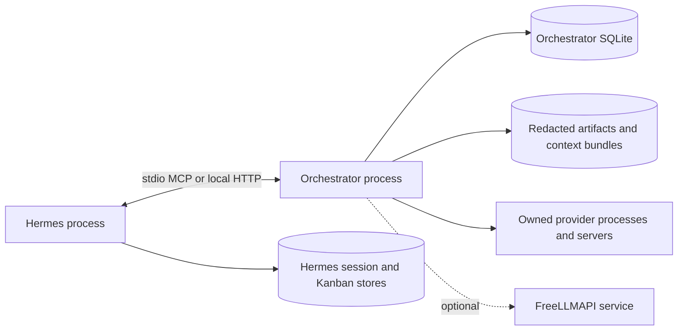
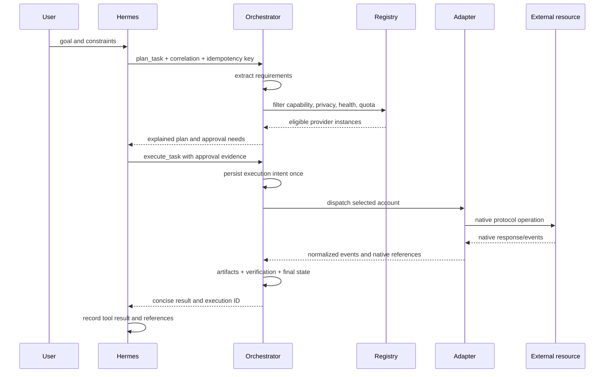

# Architecture

**Status:** proposed canonical architecture; no implementation yet
**Master specification:** [`design_draft.md`](design_draft.md)

## 1. System context

AI Orchestrator sits behind Hermes and routes tasks to heterogeneous resources. It is not a second conversational interface or a replacement model proxy.

```text
User
  → Hermes: conversation, memory, skills, native tools, approvals, Kanban
    → AI Orchestrator: plan, select, execute, correlate, recover
      → LLM APIs/gateways | coding CLIs | local model servers | browser | MCP
```

### Non-negotiable rules

1. Hermes remains the primary interface and owner of conversations, memory, skills, and native session history.
2. Every resource account is an independent provider instance with explicit authentication, state, and isolation.
3. Select the **smallest capable** resource, subject to privacy and safety—not merely the cheapest resource.
4. Use supported Hermes interfaces. Never write directly to Hermes `state.db`.
5. Prefer native structured protocols over terminal scraping and official APIs over browser automation.
6. Free-model catalogs and quotas are dynamic observations, never permanent architecture constants.
7. Verification and durable evidence precede completion.

## 2. Component model

| Component | Responsibility | Durable state |
|---|---|---|
| MCP interface | `plan_task`, `execute_task`, `get_execution`, `list_resources`, `resume_execution`, `cancel_execution` | None directly |
| Kanban lane | Long-running execution, workspace binding, review and lifecycle handoff | Hermes Kanban owns task state |
| System 1 Router | Extract requirements, filter candidates, select smallest capable resource, explain and escalate | Plans and routing evidence |
| Resource Registry | Resource/account definitions, capabilities, privacy, catalog metadata, observed health | SQLite and declarative config |
| Execution Coordinator | Idempotent dispatch, adapters, normalized events, artifacts, attempts, cancellation | SQLite plus artifact storage |
| Continuity and Recovery | Hermes correlation, native session references, context bundles, safe restart classification | SQLite and context bundles |
| Safety and Verification Policy | Trust classes, approvals, redaction, workspace boundaries, completion evidence | Policy and verification records |
| FreeLLMAPI adapter | Optional model-axis discovery, inference, health, and gateway-owned fallback | External FreeLLMAPI state |

“Account Manager,” “Task Scheduler,” “Checkpoint & Recovery,” and “Verification Engine” remain logical responsibilities, not reasons to build duplicate platforms. API credential pools belong to Hermes or the selected gateway; task lifecycle belongs to Kanban; semantic review belongs to Hermes review workflows. The orchestrator retains only resource-specific state and checks.

## 3. Deployment shape

The recommended initial deployment is one local Python process and one SQLite database:



- **MCP over stdio** is the smallest local default and avoids an extra listening port.
- A local authenticated HTTP MCP transport is acceptable when a long-running service is required.
- The Kanban lane is a small Hermes plugin; the core orchestrator remains outside Hermes.
- Adapters may spawn provider processes. Each has an explicit ownership and process-group cleanup policy.
- FreeLLMAPI is optional and must pass a fresh contract/health check before use. Its inactive service on 2026-11-19 is not treated as a working dependency.
- Remote workers, high availability, and multi-tenant deployment are future expansions.

## 4. Resource model

| Type | Examples | Selection notes |
|---|---|---|
| `llm_api` | NVIDIA NIM, OpenRouter, Groq, Gemini API | Direct configured provider/model; no hidden model router |
| `llm_gateway` | FreeLLMAPI, Kilo Gateway | Gateway may own model/key selection within its declared scope |
| `local_model_server` | Ollama or another local OpenAI-compatible server | Optional; measured capabilities and hardware determine eligibility |
| `coding_cli` | OpenCode, Kiro, Claude Code, Codex, Pi, Cline, others | Native session, account isolation, workspace and approval support |
| `browser_profile` | Dedicated Chrome profile | Identity/isolation resource, not automatically an execution backend |
| `browser_ai` | Sanctioned authenticated web AI or browser workflow | Later phase; terms, privacy, and manual-auth state gate use |
| `mcp_service` | Search, cloud, domain-specific MCP servers | External capability with its own trust and tool policy |

A driver/adapter type is not an account. `opencode:work` and `opencode:personal` must not share credentials, catalog state, or mutable session state unless the user explicitly configures that sharing.

## 5. End-to-end data flow

### 5.1 Plan and short execution



### 5.2 Long-running work

1. Hermes creates or references a Kanban card and workspace.
2. The lane requests a plan and records the execution correlation.
3. The orchestrator persists intent and idempotency information before side effects.
4. The adapter streams normalized events and artifacts.
5. Hermes receives progress/comments and a reviewer handoff.
6. Review acceptance, requested changes, blockage, or failure remains a Hermes task decision linked to the execution record.

### 5.3 Handoff

1. The current attempt ends or verification selects another resource.
2. The orchestrator chooses native resume or a portable context bundle.
3. The receiving adapter validates privacy, workspace, capabilities, and approval state.
4. A new linked attempt/execution records the handoff; native history is never assumed transferable.

## 6. State machines

### 6.1 Resource/account health

```text
registered → probing → healthy ⇄ executing
                     ↘ degraded ↔ authentication_required
healthy → cooldown → probing
healthy/degraded → disabled → manual re-probe
```

- `unknown` is valid for quota, limits, and capabilities that have not been verified.
- Health checks must not trigger login, model generation, billing, hooks, or browser automation.
- Deprecated catalog entries become ineligible even if an old static config still names them.

### 6.2 Execution

```text
planned → awaiting_approval → queued → starting → running
                                      ↘ failed_start → queued/retry
running → verifying → succeeded
running → failed | cancelled | blocked
running → interrupted → resume_native | requeue | handoff | needs_review | cancelled
```

State transitions are durable and idempotent. “Process finished” and “verification accepted” are separate milestones.

## 7. Storage boundaries

| Store | Owner | Contents |
|---|---|---|
| Hermes session store | Hermes | User messages, tool calls/results, conversation context |
| Hermes Kanban store | Hermes | Cards, dependencies, claims, runs, comments, review events |
| Orchestrator SQLite | Orchestrator | Registry, plans, executions, attempts, event index, verification, lineage |
| Artifact store | Orchestrator | Redacted logs, diffs, test output, context bundles, attachments |
| Provider-native stores | External tools | Native sessions, credentials, private execution history |

The orchestrator never treats another store as a supported write target. Cross-store consistency uses identifiers and idempotent transitions, not distributed transactions.

## 8. Security boundaries

- **Hermes boundary:** supported MCP/plugin/Kanban interfaces only.
- **Registry boundary:** validated schema and secret references; no raw credentials.
- **Adapter boundary:** redaction, explicit environment, workspace validation, native error normalization.
- **Workspace boundary:** declared root, per-task lock/worktree for code mutation, no implicit path expansion.
- **External review boundary:** only authorized, bounded, redacted snapshots.
- **Browser boundary:** dedicated profiles, manual login, terms-compliant automation, no anti-bot/quota evasion.

See [`autonomy-and-safety.md`](autonomy-and-safety.md).

## 9. Design tradeoffs

- **Python over Effect-TS/Rust/Go:** better Hermes/MCP fit; performance is I/O-bound.
- **SQLite over PostgreSQL/Redis:** enough for one local control plane and preserves inspectability.
- **Execution records before event-sourced projections:** T3's transactional intent/outbox lesson is useful, but full projection infrastructure is premature.
- **FreeLLMAPI as optional adapter:** avoids both rebuilding it and depending on an unverified inactive service.
- **Normalized events over raw transcript mirroring:** preserves continuity without flooding Hermes or leaking secrets.
- **Browser as a later scoped adapter:** honors the requirement without making fragile browser automation the foundation.

## 10. Related references

- Routing: [`system-1-router.md`](system-1-router.md)
- Registry: [`resource-registry.md`](resource-registry.md)
- Execution: [`execution-and-adapters.md`](execution-and-adapters.md)
- Continuity: [`session-continuity.md`](session-continuity.md)
- T3 evidence: [`../docs/research/13_T3_CODE_ORCHESTRATION.md`](../docs/research/13_T3_CODE_ORCHESTRATION.md)
- Roadmap: [`../phases/`](../phases/)
