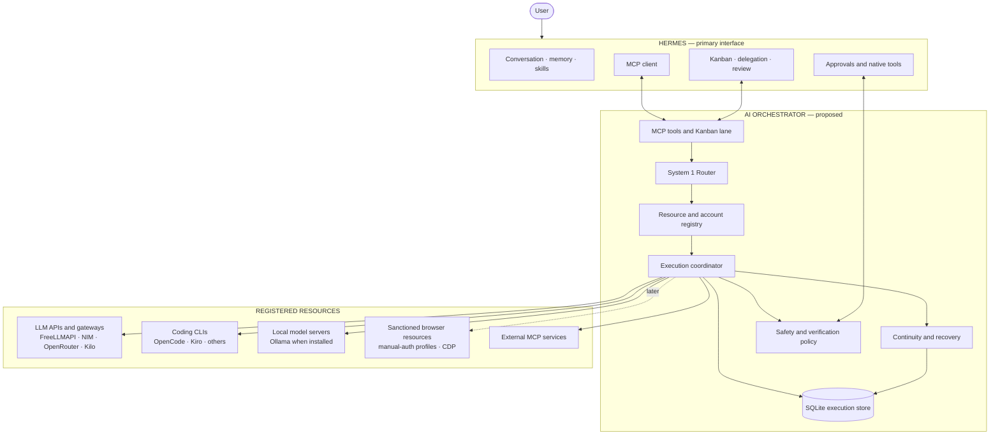

# AI Orchestrator — Design Draft

**Status:** proposed technical specification; no implementation authorized yet  
**Date:** 2026-11-19  
**Canonical audience:** system designer, implementer, reviewer, and future maintainer  
**Source requirements:** Deval's project vision, current Hermes documentation, inspected T3 Code source, and dated free-resource research  
**Working name:** AI Orchestrator (final name unresolved)

---

## 1. Problem and intended outcome

Build an intelligent, extensible resource-orchestration engine behind Hermes. From one Hermes conversation, the user should be able to assign work to the smallest capable available resource across:

- hosted LLM APIs and gateways;
- coding-agent CLIs and independent CLI accounts;
- local model servers such as Ollama when installed and appropriate;
- sanctioned browser automation and authenticated browser-AI profiles;
- MCP-backed services and, later, remote workers.

The system must select resources by task requirements, execute safely, verify results, recover from failures, and keep every execution discoverable and continuable from the originating Hermes conversation.

Hermes remains the primary interface. This project does not replace Hermes, its memory, skills, session store, native tools, or skill-creation workflow.

## 2. Non-goals and boundaries

The initial system is not:

1. another chat UI, desktop UI, or general-purpose agent framework;
2. a replacement for Hermes Kanban, delegation, credential pools, memory, or session storage;
3. a second model proxy when FreeLLMAPI or Hermes already owns a model route;
4. a promise of lossless cross-CLI session transfer;
5. a quota-evasion, credential-farming, CAPTCHA-bypass, or subscription-sharing system;
6. a multi-tenant SaaS, Kubernetes deployment, remote-worker fleet, or high-availability service;
7. an infinite raw-log retention system or a guarantee that free providers remain available;
8. a requirement to install every supported CLI or browser service in the first phase.

## 3. Current behavior and evidence

### 3.1 Verified project state

- This repository contains documentation only; there is no orchestrator implementation to preserve.
- The initial short specs conflict with later research about browser support, local inference, storage, FreeLLMAPI, and component ownership.
- The user's current requirements include local models and browser AI in the unified pool. Older recommendations to remove them are therefore not canonical.
- Hermes currently provides native MCP client integration, delegation, durable Kanban workflows, credential management, sessions, memory, and skills.
- FreeLLMAPI source exists at `/home/deval/freellmapi`, but its user service was `inactive` when checked on 2026-11-19 and its working tree had extensive modifications. Historical model counts and endpoint behavior are not current runtime facts.
- OpenCode's free catalog demonstrates model churn: its official page marked `GLM-5.3-Flash Free` deprecated on 2026-11-18, while a direct `opencode/deepseek-v4.1-flash-free` smoke test succeeded on 2026-11-19. Resource discovery must be dynamic.
- T3 Code was inspected at commit `a6d2bed55b8ea1b4be27c9c77fdd65e0e7d479d5`; see [`../docs/research/13_T3_CODE_ORCHESTRATION.md`](../docs/research/13_T3_CODE_ORCHESTRATION.md).

### 3.2 Evidence classes used in this documentation

- **Requirement:** explicitly chosen by the user.
- **Verified:** checked against current local state, source code, or official documentation on the stated date.
- **Proposal:** recommended design awaiting approval or implementation verification.
- **Historical:** was true in an earlier research window and is retained only for context.
- **Unknown:** no reliable current evidence; must not become an implementation assumption.

## 4. Chosen approach

Create one local-first Python service with a small Hermes integration surface:

1. **Hermes integration:** native MCP for planning, short execution, inspection, resume, and cancellation; Hermes Kanban for durable/long-running work and review.
2. **Unified registry:** resources, independent accounts, declared capabilities, privacy policy, limits, and observed health.
3. **System 1 router:** deterministic requirement extraction and policy filtering first; a bounded model classifier only for ambiguous tasks; capability-based selection and explicit escalation.
4. **Execution coordinator:** thin adapters, normalized events, idempotent dispatch, artifacts, native session identifiers, and resource-level checkpoints.
5. **Continuity layer:** Hermes correlation IDs, execution records, context bundles, and handoff history.
6. **Safety and verification:** explicit trust classes, approval boundaries, secret redaction, adapter checks, and Hermes review/rework.
7. **Optional model gateway integration:** FreeLLMAPI can own model/key/fallback selection inside an `llm_gateway` resource when restored and verified. It is not a mandatory second control plane.

“Local-first” means local control infrastructure and local durable records. It does not prohibit cloud inference and does not require local inference hardware.

## 5. Architecture



### 5.1 Responsibility ownership

| Responsibility | Owner | What the orchestrator must not duplicate |
|---|---|---|
| Conversation, memory, skills, session transcript | Hermes | Direct writes to Hermes `state.db` or skill/memory internals |
| Interactive orchestrator tools | MCP server | A custom chat protocol or UI |
| Durable task queue, dependencies, review/rework, worker lifecycle | Hermes Kanban | A second general task scheduler |
| Short bounded fan-out | Hermes `delegate_task` where suitable | A custom subagent protocol for every task |
| API-key pools and configured provider fallback | Hermes or the selected gateway | A third independent key-routing policy |
| Model-to-model selection within a gateway | FreeLLMAPI when configured | Copying its catalog, bandit routing, cooldowns, and provider quirks |
| Task-to-resource-type selection | AI Orchestrator System 1 | Provider-specific conditionals spread through adapters |
| Account/config/process isolation | Adapter plus registry | Assuming one global `HOME` means isolation |
| Native execution/session state | Resource adapter and execution store | Treating CLI private sessions as Hermes sessions |
| Resource checkpoints and artifacts | Orchestrator | Infinite unredacted provider-frame retention |
| Semantic review and completion handoff | Hermes Kanban reviewer/worker | A bespoke general review engine |

## 6. Public interface

The first MCP surface should remain small. Exact schemas are implementation contracts to validate before coding, not existing APIs.

| Tool | Purpose | Important inputs | Result |
|---|---|---|---|
| `plan_task` | Classify and select without executing | goal, workspace, constraints, context reference, idempotency key | plan ID, requirements, selected account/resource, alternatives, explanation, approval needs |
| `execute_task` | Execute an approved plan or return an existing execution | plan ID, approval token when required, idempotency key | execution ID, status, output, artifacts, native session references |
| `get_execution` | Read status, events, artifacts, errors, usage, and lineage | execution ID, event cursor, detail level | durable execution view |
| `list_resources` | Inspect registered resources and current health | type, capability, availability, privacy filter | redacted resource/account list |
| `resume_execution` | Resume native state or create a portable handoff | execution ID, target resource preference, idempotency key | new linked execution or rejection |
| `cancel_execution` | Request cooperative cancellation | execution ID, reason | cancellation state |

### 6.1 Plan-before-execute

`plan_task` never performs billable work. A plan includes:

- inferred domain and task shape;
- required capabilities, minimum capability tier, context size, tools, workspace, and privacy class;
- selected resource **instance/account**, not only a driver name;
- rejected candidates with concise reasons;
- retry/fallback/escalation policy and spending/concurrency caps;
- approval requirements and unknowns that could change selection.

`execute_task` accepts only a valid, unexpired plan and the required approval evidence. Duplicate idempotency keys return the original result rather than executing twice.

### 6.2 Synchronous versus durable execution

- Short LLM calls and bounded read-only tasks may return through one MCP call.
- Long-running, code-mutating, parallel, approval-heavy, or human-review tasks use Kanban.
- A Kanban worker finishes through the required Hermes lifecycle handoff; the orchestrator does not mark its own card complete independently of that contract.
- MCP tool results contain concise progress and references. Full events and large artifacts remain queryable through `get_execution` and Hermes attachments.

## 7. Registry and data model

### 7.1 Identity separation

| Identifier | Owner | Purpose |
|---|---|---|
| Hermes session ID | Hermes | User-facing conversation |
| Hermes tool-call ID | Hermes | Interactive correlation |
| Kanban task ID and run ID | Hermes | Durable task and worker attempt |
| Plan ID | Orchestrator | Immutable routing decision |
| Execution ID | Orchestrator | One dispatched execution |
| Attempt ID | Orchestrator | Retry/escalation attempt within an execution |
| Resource ID | Orchestrator | Adapter type plus logical endpoint/model capability |
| Account/provider-instance ID | Orchestrator | Independent credentials and mutable account state |
| Native session/thread/turn IDs | External resource | Native resume and event correlation |
| Context bundle ID | Orchestrator | Portable handoff input |
| Artifact ID | Orchestrator | File/log/diff/test evidence |

No field should be overloaded to represent several of these.

### 7.2 Resource record

A resource describes a reusable execution target:

```yaml
id: opencode-console-free
type: coding_cli
adapter: opencode_acp_or_http
capabilities:
  task_domains: [code, debugging, repository_work]
  strength_tier: 6
  context_window: null
  features: [streaming, native_resume]
privacy:
  class: provider_dependent
  training_policy: dynamic_requires_verification
selection:
  cost_tier: free
  preference: normal
catalog:
  source: live_provider_catalog
  last_verified_at: null
```

`null` means unknown, not unlimited or absent. `strength_tier` is local policy metadata, not a provider-published universal benchmark.

### 7.3 Account/provider-instance record

Each independent account holds only references and state:

- account ID, resource ID, enabled state;
- secret reference such as `env:VARIABLE`, never a secret value;
- explicit environment/config-directory map;
- owned process/server policy;
- provider-specific quota metadata and unknowns;
- privacy and region eligibility overrides;
- observed health: available, degraded, cooldown, authentication required, disabled;
- last error class, reset time, failure count, and verification timestamp.

Declared configuration and observed runtime state are stored separately.

### 7.4 Execution record

An execution stores goal, plan, task correlations, resource/account, workspace, status, attempt count, native references, output summary, artifact index, verification verdict, usage/cost where exposed, error class, and timestamps. Raw secrets are prohibited. Large output is stored as bounded/redacted artifacts rather than inlined into every conversation turn.

## 8. System 1 routing

### 8.1 Two routing axes

1. **Resource-type axis:** LLM API/gateway, coding CLI, local model server, browser, MCP service, or multiple coordinated resources.
2. **Model/provider axis:** the specific model/key/upstream inside the selected resource. FreeLLMAPI or Hermes owns this axis only where already configured.

The orchestrator must not rebuild the second axis inside FreeLLMAPI.

### 8.2 Decision pipeline

```text
Goal + constraints + context metadata
  → deterministic requirement extraction
  → optional bounded model classification for ambiguity
  → hard policy filters
  → capability and health filters
  → smallest capable candidate
  → preference ordering and explanation
  → plan
```

Hard filters include privacy, required features, workspace access, account health, region eligibility, concurrency, budget, and user exclusions. Cost never overrides capability or confidentiality.

Candidate order is lexicographic:

1. satisfies every hard requirement;
2. lowest sufficient capability tier;
3. preferred resource class for the task shape;
4. privacy and locality preference;
5. expected reliability/latency/cost using available evidence;
6. stable deterministic tie-breaker.

Do not invent numeric estimates when a provider does not expose them. Unknown values remain unknown and produce an explanation, not false precision.

### 8.3 Classification policy

Start without training infrastructure:

- explicit user constraints and adapter-independent rules first;
- a small maintained evaluation set for task shapes and expected resource classes;
- a bounded free/low-cost classifier only for ambiguous tasks, through a configured resource;
- cache decisions by a hash of goal, constraints, and relevant registry version;
- fail closed on malformed classification or use a conservative human-review route.

The exact classifier model is configurable and may change. `kilo-auto/free`, an OpenCode free model, or a FreeLLMAPI decision endpoint are candidates, not permanent dependencies. Confidential prompts may not be sent to a free classifier with unsuitable data-use terms.

### 8.4 Retry, fallback, and escalation are different

- **Retry:** same account/resource for a bounded transient failure.
- **Fallback:** equivalent healthy account/resource after cooldown, authentication, availability, or provider failure.
- **Escalation:** higher capability tier or different resource type after verification shows the result is insufficient.
- **Handoff:** new execution with native resume or a portable context bundle.

All are bounded by attempt, time, concurrency, and spend limits. A 429 is not evidence that a stronger model is needed.

## 9. Adapter contract and normalized events

Adapters hide provider protocols, not resource policy. Capabilities must be truthful and tested.

Conceptual operations:

- `describe()` — static and dynamically discovered capabilities;
- `health()` — side-effect-free status; never triggers login, model generation, hooks, or billing;
- `open()` / `start()` — create or attach native execution state;
- `stream()` — yield normalized events;
- `interrupt()` — cooperative cancellation with a defined force-stop path;
- `resume()` — native resume when supported;
- `close()` — release owned processes, servers, and listeners.

Normalized event types:

- execution/attempt lifecycle;
- assistant text and reasoning summary where exposed;
- tool call/result and approval request;
- artifact created/updated;
- native session/thread/turn reference;
- usage/limit/cooldown;
- verification result;
- error and cancellation;
- child task created/completed.

Provider-native subagents and application-owned child tasks have different lifecycle records. A child may outlive the parent's turn and must be correlated by child identity, not whichever parent attempt is currently active.

## 10. Session continuity and handoff

### 10.1 Continuity means correlated access, not database merging

Hermes owns the conversation. The orchestrator owns execution truth. The same Hermes conversation can inspect or resume an execution because its tool calls and Kanban cards reference stable execution IDs.

Do not write directly to Hermes `state.db`. Do not claim every raw provider frame belongs in the Hermes transcript. The transcript carries useful summaries and references; complete redacted execution evidence remains queryable.

### 10.2 Portable context bundle

A handoff bundle contains only what the next resource needs:

- objective and acceptance criteria;
- relevant decisions and constraints;
- concise prior-attempt history and errors;
- workspace and artifact references;
- changed-file/test summary;
- native session reference if the same resource supports resume;
- open questions and approval state;
- privacy classification and redaction report.

The receiving adapter validates the bundle and workspace. It must not silently copy secrets, unrelated history, or another account's credentials.

### 10.3 Recovery outcomes

After process loss, classify each unfinished attempt:

| Outcome | Condition |
|---|---|
| `retry` | Prompt/operation was not accepted and is safe to repeat |
| `resume_native` | Provider supports resume and native state is valid |
| `requeue` | Durable effect can be replayed without duplicate side effects |
| `handoff` | Another resource receives a portable context bundle |
| `needs_review` | Side effects are uncertain or workspace state diverged |
| `cancel` | Native process is gone and no safe continuation exists |

A running status alone does not prove the provider accepted the prompt. Recovery must not blindly repeat code-mutating operations.

## 11. Security, privacy, and approval

### 11.1 Trust classes

| Class | Examples | Policy |
|---|---|---|
| A — bounded/read-only | catalog reads, side-effect-free health, summarization without tools | automatic within privacy and budget policy |
| B — reversible workspace work | code edits in an isolated worktree, local tests | automatic only in declared workspace and resource permissions |
| C — consequential/external | git push, PR merge, deploy, non-local DB writes, deletion outside scratch, package installation | explicit user approval |
| D — prohibited | quota farming, CAPTCHA bypass, credential extraction/sharing, undisclosed secret logging, unsupported state.db writes | refuse |

Network access is not automatically high risk for an allowlisted inference call; sensitive data destination and action consequence determine the class.

### 11.2 Account and secret safety

- Store secret references only; resolve at execution time.
- Construct each account's environment explicitly and remove ambient credentials it did not declare.
- Redact before logs, artifacts, events, model handoffs, and external reviews.
- Do not expose credentials to browser profiles, CLIs, or MCP servers that do not require them.
- One shared background server per account only when the provider's isolation model proves it safe; otherwise one per task or account as required.

### 11.3 Integration and client terms

An adapter is allowed only when the provider's terms permit that integration shape. Record client/embedding restrictions with the resource. OpenCode free chat models and Cline promotions must not be repackaged as generic APIs when limited to their own clients. Antigravity's consumer terms do not support wrapping `agy` inside third-party coding agents or account rotation; use only a permitted direct/API/enterprise path. Unknown integration permission leaves the route disabled.

### 11.4 Browser policy

Browser support is a later phase, not a blanket prohibition and not a bypass mechanism:

- use Hermes browser/CDP tooling or a supported automation framework;
- dedicated manually authenticated profiles;
- only services whose terms and product controls permit the intended automation;
- no CAPTCHA solving, anti-bot evasion, cookie extraction, or rotation to defeat quotas;
- pause for manual authentication and mark that state honestly;
- prefer official APIs whenever they provide equivalent capability.

## 12. Verification and completion

Completion requires evidence appropriate to the task:

1. output schema and requirement checks;
2. exit status and adapter-normalized error checks;
3. tests/lint/type checks for code when available and relevant;
4. changed-file and artifact inspection;
5. security/privacy checks at trust boundaries;
6. semantic review through Hermes Kanban for consequential work;
7. explicit unresolved issues when full verification is not possible.

A model saying “done,” a commit existing, or a process exiting zero is not sufficient by itself. Verification failure can trigger rework or escalation, with bounded attempts.

## 13. Recommended stack

| Concern | Proposal | Reason |
|---|---|---|
| Runtime | Python 3.12+ and `asyncio` | Hermes plugin ecosystem and I/O-bound adapters |
| Public integration | Native MCP plus a small Kanban lane | Supported direction; no Hermes source fork |
| Validation | Pydantic v2 | Contracts and JSON Schema |
| Persistence | SQLite with versioned SQL migrations and WAL | Local, durable, queryable, no extra service |
| MCP | FastMCP/`mcp` Python SDK | Small standards-based server |
| HTTP/process | `httpx` and `asyncio.create_subprocess_exec` | Streaming and owned process groups |
| Tests | `pytest`, `pytest-asyncio`, recorded provider fixtures | No live dependency for normal CI |
| Secrets | Existing Hermes/provider secret references | Avoid a new credential store |

Do not add an ORM, agent framework, Redis, PostgreSQL, Kubernetes, metrics server, or Effect-TS runtime until measured requirements justify them.

## 14. Alternatives considered

| Alternative | Verdict |
|---|---|
| Fork/adopt T3 Code | Reject initially; second UI and Effect-TS stack. Reuse patterns, not the application. |
| Build everything inside a Hermes plugin | Reject for long-running service state and multiple adapters; keep only the lane/tool integration small. |
| Make FreeLLMAPI the whole orchestrator | Reject; strong model-axis gateway candidate, but not cross-resource task lifecycle or Hermes continuity. |
| Rebuild model routing directly | Reject where FreeLLMAPI/Hermes already owns it. |
| Direct provider adapters only | Accept as a simple fallback when no gateway is configured; no hidden third router. |
| Hermes delegation provider for all execution | Reject; appropriate for Hermes child models, not arbitrary CLI accounts/workspaces. |
| Direct writes to Hermes session DB | Prohibit; unsupported coupling and continuity risk. |
| Browser-only access to every service | Reject; prefer official APIs and native CLI protocols. |

## 15. Implementation sequence

Detailed acceptance criteria live in [`../phases/`](../phases/).

1. **Foundation:** validated registry, one resource vertical slice, execution store, MCP planning/execution/inspection.
2. **Intelligence:** System 1 policy, evaluation set, dynamic discovery, bounded fallback/escalation.
3. **Execution:** coding CLI adapters, account isolation, normalized events, worktrees, Kanban lane, local-model adapter when needed.
4. **Browser:** one sanctioned manually authenticated browser resource under the safety policy.
5. **Continuity:** complete handoff, native resume, restart recovery, verification and cost/usage views.
6. **Advanced:** coordinated parallel agents, adaptive routing evidence, optional remote workers.

Each phase must produce a verified vertical result before expanding breadth.

## 16. Acceptance tests for the design

### Foundation

- Register two accounts for one resource and demonstrate separate environment/configuration state without exposing secrets.
- Plan and execute one small task through Hermes MCP and retrieve the correlated execution record.
- Repeat an idempotency key and prove no duplicate upstream call occurred.
- Disable a resource and prove planning rejects it with an explanation.

### Routing

- Simple classification never routes to a repository-mutating CLI without a reason.
- A confidential task is rejected from resources with unsuitable data-use policy.
- A deprecated/removed model disappears after catalog refresh and is not selected.
- Quota exhaustion triggers fallback, not unnecessary capability escalation.

### Execution and recovery

- Stream a coding CLI task into normalized events with native session references.
- Kill the orchestrator before and after provider acceptance; verify the correct recovery outcome in each case.
- Cancel a process tree and verify no owned child remains.
- Resume natively where supported and hand off with a context bundle where not.

### Continuity and verification

- From the original Hermes conversation, retrieve full redacted execution history and artifacts after a later session resumes.
- A reviewer can reject an implementation and route bounded rework without losing lineage.
- Large logs and secrets never enter the Hermes transcript or reviewer input unintentionally.

### Browser and local resources

- A manually authenticated browser profile that requires login becomes `authentication_required`, not `healthy`.
- CAPTCHA or prohibited automation causes refusal, not an evasion attempt.
- A local model server is selected only when its measured capabilities satisfy the task.

## 17. Rollout and rollback

- Introduce read-only registry/planning first, then short read-only execution, then isolated workspace writes.
- Keep adapters behind configuration flags and disabled until their smoke/fixture checks pass.
- Version registry, event, context-bundle, and SQL schemas from the beginning.
- Rollback by disabling new adapters/routes and preserving the SQLite store; do not delete execution history.
- Never roll back by modifying Hermes's internal database or deleting a user's native CLI sessions.
- FreeLLMAPI integration is conditional on a clean health check and contract probe; failure leaves direct configured resources usable.

## 18. Unresolved decisions

These are explicit and should not be silently filled during implementation:

1. Final project name.
2. Initial System 1 classifier resource and confidence threshold after evaluation; the architecture does not hardcode one.
3. Whether FreeLLMAPI will be restored and designated the primary model gateway, or remain one optional adapter.
4. Exact first-wave CLI set beyond the first vertical slice; OpenCode is the recommended first CLI because of its structured interfaces, not because every other CLI is excluded.
5. Verification thresholds for automatic completion versus mandatory human review by task class.
6. Retention periods for raw events, artifacts, and provider diagnostics.

The recommended defaults for storage, language, MCP/Kanban integration, resource-instance identity, and recovery semantics are sufficiently determined to review and prototype after approval.

## 19. Related documents

- [`architecture.md`](architecture.md) — component and responsibility reference
- [`system-1-router.md`](system-1-router.md) — selection and escalation policy
- [`resource-registry.md`](resource-registry.md) — registry/account/catalog reference
- [`execution-and-adapters.md`](execution-and-adapters.md) — adapter/event/recovery contract
- [`session-continuity.md`](session-continuity.md) — correlation and handoff model
- [`autonomy-and-safety.md`](autonomy-and-safety.md) — trust, privacy, browser, and verification policy
- [`resource-catalog.md`](resource-catalog.md) — dated candidate resource landscape
- [`../references/decisions.md`](../references/decisions.md) — user requirements and design-choice status
- [`../references/open-questions.md`](../references/open-questions.md) — unresolved decisions
- [`../docs/research/13_T3_CODE_ORCHESTRATION.md`](../docs/research/13_T3_CODE_ORCHESTRATION.md) — source-inspected T3 analysis
