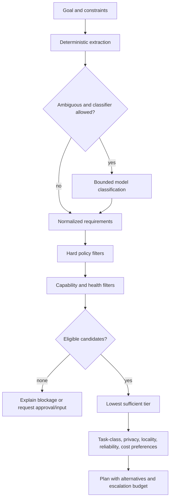

# System 1 Router

**Status:** proposed routing contract
**Principle:** use the smallest capable resource, not simply the cheapest available resource.

## 1. Scope

System 1 selects a **resource instance/account** for a task and produces an inspectable plan. It does not execute provider-specific protocols and does not replace model routing already owned by Hermes or a gateway.

Two independent decisions exist:

1. **Task-to-resource selection:** this router's responsibility.
2. **Model/key/upstream selection inside a resource:** Hermes, FreeLLMAPI, Kilo, OpenCode, or another configured gateway may own it.

A plan must name both boundaries so no third router silently appears.

## 2. Inputs

| Input | Required | Notes |
|---|---|---|
| Goal and acceptance criteria | yes | User intent, not only a model prompt |
| Hermes/Kanban correlation | yes for execution | Preserves continuity |
| Workspace and access needs | for workspace tasks | Absolute root plus read/write requirement |
| Required capabilities | inferred or explicit | Tools, vision, code edits, browser, resume, structured output |
| Privacy class | yes | Confidentiality, provider data-use and region constraints |
| Budget and latency constraints | optional | Unknown cost/time is not zero |
| Resource/account preferences | optional | Allow/deny lists and preferred locality |
| Registry and catalog snapshot | yes | Declared capabilities and observed health |
| Prior attempts and verification | for retry/escalation | Prevents blind repetition |

## 3. Requirement extraction

The router derives a normalized requirement object:

```yaml
domain: debugging
task_shape: repository_modification
minimum_tier: 6
required_features: [filesystem_write, test_execution, streaming]
context:
  estimated_input_tokens: null
  artifacts: [repo://current-workspace]
constraints:
  privacy: confidential
  allow_browser: false
  max_attempts: 3
  max_spend_usd: 0
execution:
  workspace: /absolute/workspace
  needs_review: true
```

`null` means unknown. Do not turn missing measurements into invented token, latency, price, or quality estimates.

### 3.1 Initial task-shape map

This is local policy to calibrate with evidence, not a universal model ranking.

| Task shape | Typical resource class | Indicative minimum tier* |
|---|---|---|
| Classification, extraction, short transformation | small/fast LLM | 1–2 |
| Summarization, drafting, ordinary Q&A | economical LLM | 2–3 |
| Structured reasoning, difficult analysis | stronger reasoning LLM | 4–6 |
| Single-file code suggestion without workspace writes | coding-capable LLM | 4–5 |
| Repository implementation/debugging with files and tests | coding CLI | 6–8 |
| Large independent workstreams | coordinated coding resources | 7–9 |
| Authenticated web-only workflow | sanctioned browser resource | capability-specific |
| Sensitive/local-only inference | eligible local model server | measured per model |

\* Tier values are relative ordering only. They are not provider-published facts and do not map mechanically to parameter count or price.

## 4. Decision pipeline



### 4.1 Deterministic first

Start with explicit user constraints and maintained task-shape rules. Do not send every goal to another model merely to discover that it needs a coding CLI.

### 4.2 Model classification only when useful

A bounded classifier may handle ambiguous domain/tier/capability extraction when:

- the goal is too ambiguous for rules;
- its privacy terms allow the content;
- a suitable configured free/low-cost resource is healthy;
- its output validates against the requirement schema.

The exact model is configuration, not architecture. Candidates include Kilo Auto Free, an OpenCode free model, or a verified FreeLLMAPI decision route. A classifier failure produces a conservative plan or a request for clarification, never an unconstrained expensive execution.

## 5. Filtering and ordering

### 5.1 Hard filters

A candidate is ineligible when any answer is false:

- enabled and supported by a working adapter;
- satisfies minimum tier and all required features;
- supports the workspace and risk class;
- meets privacy, data-use, region, retention, and client/embedding permission requirements;
- is not cooling down, deprecated, unauthenticated, disabled, or over its concurrency cap;
- fits per-task spend, time, and attempt limits;
- has required catalog freshness or has passed a fresh availability probe.

Unknown is not automatically `true`. Whether unknown is acceptable depends on the requirement: unknown price may be acceptable for a declared free endpoint; unknown data training policy is not acceptable for confidential work.

### 5.2 Ordered selection

Eligible candidates are ordered lexicographically:

1. lowest sufficient capability tier;
2. preferred resource class for the task shape;
3. strongest privacy/locality fit;
4. observed reliability and recent verification evidence;
5. expected latency and cost, if known;
6. stable resource/account ID as deterministic tie-breaker.

Do not collapse these into an unexplained weighted score. The plan should make the decision auditable.

## 6. Plan output

Every plan contains:

- normalized requirements and ambiguity warnings;
- selected resource ID, provider-instance/account ID, adapter, and model-route scope;
- why the candidate was selected;
- rejected candidates and concise reasons;
- required approvals and privacy classification;
- idempotency key and registry/catalog version;
- retry, fallback, escalation, concurrency, time, and spend limits;
- fallback candidates or an explicit “no eligible fallback” result.

`plan_task` performs no billable model generation. Catalog reads and side-effect-free health metadata are allowed; an expensive availability probe requires separate policy.

## 7. Retry, fallback, escalation, handoff

| Mechanism | Trigger | Selection behavior | Boundaries |
|---|---|---|---|
| Retry | timeout, transient 5xx, disconnected stream before acceptance | same account/resource | bounded attempts and backoff |
| Fallback | 429/402, cooldown, unavailable account, provider outage | equivalent healthy resource/account | honor reset and provider concurrency |
| Escalation | output fails capability/verification requirements | next sufficient tier or resource class | bounded by attempts/spend and actual failure evidence |
| Native resume | same resource and valid native state | continue native session/thread | provider capability must be true |
| Handoff | different resource or incompatible native history | new linked execution with context bundle | privacy/workspace revalidation |
| Human input | unclear goal, risky action, no eligible resource | no execution | explain exact blocker |

A rate-limit error is not a reason to choose a smarter model. A bad answer is not a reason to rotate accounts to evade a provider limit.

## 8. Failure classification

| Class | Examples | Router action |
|---|---|---|
| `invalid_plan` | malformed requirement, missing workspace | reject before execution |
| `approval_required` | consequential external action | wait for explicit approval |
| `privacy_blocked` | unsuitable training/retention/region terms | exclude resource |
| `authentication_required` | expired CLI login, manual browser login | pause and request user action |
| `rate_limited` | 429 with/without reset | cooldown and eligible fallback |
| `quota_exhausted` | billing/monthly allowance exhausted | disable until verified reset; never farm accounts |
| `provider_unavailable` | network, 5xx, process crash | bounded retry/fallback |
| `capability_mismatch` | missing tools, context, file writes, resume | exclude and replan |
| `verification_failed` | tests/output/review fail | bounded rework or escalation |
| `unknown_side_effects` | crash after mutation or provider acceptance | require review before replay |

## 9. Evaluation and learning

Start with a small versioned evaluation set rather than a training pipeline:

- representative tasks for each resource class and privacy class;
- expected minimum tier and required features;
- expected fallback behavior for 401, 402, 429, timeout, deprecated model, and malformed classifier output;
- confidential prompts that must never reach training-enabled endpoints;
- insufficient outputs that should trigger escalation rather than fallback.

Record plan choice, execution outcome, verification verdict, latency, provider-reported usage, and human override. Use that evidence to adjust the local task-shape/tier mapping. Adaptive bandit routing is deferred until the dataset justifies it.

## 10. Acceptance criteria

- A simple task selects the lowest sufficient healthy resource with an explanation.
- A repository-mutating task cannot select a text-only LLM lacking workspace tools.
- A confidential task cannot select a resource with unsuitable or unknown data-use terms.
- A deprecated model becomes ineligible after catalog refresh.
- A duplicate plan/execute idempotency key never repeats upstream work.
- A 429 triggers cooldown/fallback without increasing capability tier.
- A failed verification triggers bounded rework/escalation with preserved lineage.
- Every plan identifies who owns model/key routing inside the selected resource.
